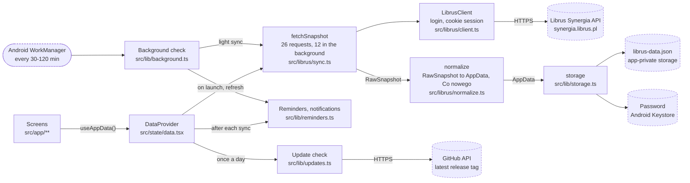

# Architecture

The app is one loop: log in, download a fixed set of lists, turn them into one
JSON document, save it, draw every screen from it. Nothing on screen waits for
the network.

GitHub draws this as a diagram you can zoom and drag. Dashed shapes are
outside the app: Librus, GitHub and parts of Android.

## Folders

| Path | What is in it |
|---|---|
| `src/librus/` | Everything that knows about Librus. Plain TypeScript, no React, `fetch` passed in, so it runs under Node too. |
| `src/state/data.tsx` | `DataProvider`: when to sync, what to do when it fails, the state screens read. |
| `src/lib/` | Storage, settings, dates, and the school rules (what counts as a test, how an average is weighted). |
| `src/ui/` | Theme tokens and shared components. |
| `src/app/` | Screens. Expo Router turns each file into a route. |
| `plugins/` | Config plugins that change the generated Android project. |

## 1. Login: `src/librus/client.ts`

Librus has no public API. The official app logs in through the same OAuth pages
a browser uses and then calls `synergia.librus.pl/gateway/api/2.0` with the
cookies that leaves behind. `LibrusClient.login` replays that: open the portal
page, post the login form (with the `X-Baner` header Librus checks), call
`PerformLogin` twice and `Grant`, then confirm with `Auth/TokenInfo`. The steps
come from librus-sdk; see `NOTICE`.

The client never handles a token. On Android, `expo/fetch` with
`credentials: 'include'` keeps the cookies in the system CookieManager, so the
session survives app restarts and most syncs skip the login entirely.

`me()` is how every sync starts: it asks for `Me`, and only if that fails does
it read the saved password and log in again.

Errors carry a `kind`, and the rest of the app acts on it:

| kind | Meaning | What the app does |
|---|---|---|
| `network` | The request never reached Librus. | Safe to retry at once; Librus saw nothing. |
| `auth` | Librus answered and refused the login. | Stop all automatic syncing until the user signs in again. |
| `http` | Librus answered with an error, 5xx included. | Wait out the normal 6 hours. |

## 2. Download: `src/librus/sync.ts`

`plan()` is the whole request budget: 21 list endpoints, three timetable weeks
(last, this, next) and today's lucky number. With `Me` that makes 26.
`fetchSnapshot` runs them one at a time with a 400 ms pause.

Only `Me` may fail the sync. Every later request that fails is stored as
`{ error }` in its slot, so one broken endpoint costs one missing section, not
a second full run.

`fetchWeek` is the one request outside a sync: the calendar calls it when the
user scrolls to a week that is not in the copy.

## 3. Shape: `src/librus/normalize.ts`

Librus returns lists of objects that point at each other by id: a grade has a
subject id, a category id and a teacher id. `normalize` resolves those once and
produces `AppData` (`src/librus/types.ts`): lessons per week, grades,
homework, attendance, notices, free days, the subject list and the lucky
number. Screens never see a Librus id.

Two details worth knowing:

- The subject list comes from the student's own timetable, grades and
  attendance, not from Librus's `Subjects`, which lists every subject in the
  school.
- Timetable weeks from the previous copy are kept, so weeks fetched by
  scrolling survive the next sync.

A section whose request failed keeps its copy from the previous sync and is
listed in `AppData.failed`, which Konto shows as "Nie pobrano".

`normalize` also builds `AppData.news` for Co nowego by comparing ids with the
previous copy: new grades, entries, notices, notes, behaviour grades and
teacher absences. It adds nothing on the first sync, when everything would be
"new", and skips any section that failed in either sync, so a section that
comes back after a failure is not reported as a pile of new entries. Entries
older than 30 days drop off.

## 4. When to sync: `src/state/data.tsx`

`DataProvider` owns the rules from the README:

- On launch it loads `librus-data.json` and shows it immediately. It syncs
  only if the copy is over 6 hours old, a password is saved, and the last
  failure (other than being offline) is not recent.
- `refresh()` (pull to refresh) is ignored within 3 minutes of the last
  attempt, unless that attempt failed for lack of network.
- `inFlight` makes two syncs impossible: a second call gets the first one's
  promise.
- `signIn` logs in before saving anything, so a mistyped password never
  reaches the keystore.
- After a rejected saved password, `loginRejected` is written to
  `librus-sync.json`, and nothing syncs again until the user signs in.

Screens call `useAppData()` for the data and `useData()` for status, errors
and the actions.

### Background check: `src/lib/background.ts`

Off unless the user picks an interval in Konto. `index.js` defines the task
before expo-router loads, because WorkManager can start the JavaScript with
no screen. Each run:

- does nothing between 22:00 and 6:00, without a saved login, after a
  rejected password, or when the copy is under 10 minutes old;
- fetches the light plan from `sync.ts` (12 requests: grades, entries,
  notices, notes, teacher absences, this and next week's timetable);
- merges it with `normalize`, which keeps every section it did not fetch and
  leaves `fullSyncedAt` alone, so the six-hour full sync still happens;
- saves the copy, reschedules reminders and sends one notification for the
  new `news` entries. A tap opens Co nowego.

If the app is open, `DataProvider` gets the new copy through
`onBackgroundData`; if it was closed, it reloads the file when it comes back
to the foreground.

## 5. Storage: `src/lib/storage.ts`

| What | Where |
|---|---|
| Login and password | `expo-secure-store`, encrypted with an Android Keystore key. |
| School data | `librus-data.json` in the app's private documents folder. Written to a `.tmp` file first, then moved into place. |
| Last sync failure | `librus-sync.json`, same folder. |
| Theme, goals, reminder switch, last seen Co nowego entry | `librus-settings.json` (`src/lib/settings.ts`). |
| Scheduled reminders | Android's alarm list, rebuilt after each sync (`src/lib/reminders.ts`). |
| Session cookies | Android's CookieManager, private to the app. |

Konto > Wyloguj (`signOut`, then `wipe()`) deletes the password, the data, the failure record, the cookies and the scheduled reminders. The settings file stays, so the theme and goals survive a re-login.

On web, which is for UI work only, the same functions use `localStorage`, and
the data comes from `public/fixture.json` because Librus refuses browser
requests.

## 6. Screens and design: `src/app/`, `src/ui/`

`src/app/_layout.tsx` sends the user to `login` until there is data, and to
the tabs after. `(tabs)/` holds the five tabs; `przedmiot/[name].tsx` is one
subject; `konto` and `zaloguj` open as modals.

`src/ui/theme.ts` starts with the colour rule the screens follow: colour means
"look at this", never a category. Ink (black or white) is for anything
tappable, orange for tests, red for problems, green for good news, and the
accent only for what is happening now. Cards are separated by shadows in light
mode and hairlines in dark mode.

`src/lib/school.ts` holds the decisions about school data: which homework
category is a test or a kartkówka, which attendance types count as absent, the
weighted average, and the thresholds for colouring grades and rates.

## 7. Android config: `plugins/`

`android/` is generated by `npx expo prebuild` and never edited by hand. Two
local plugins change it:

- `withPrivacy.js` turns off Google backups and Android 12+ device transfer
  for all of the app's files. Otherwise the data and session cookies would be
  copied off the phone.
- `withReleaseSigning.js` signs release builds with a private key from
  `~/.gradle/gradle.properties` when one is configured, and with the public
  debug key otherwise.

`app.json` also blocks permissions that dependencies would otherwise add
(storage, overlay, biometrics, and the push, install-referrer and launcher
badge permissions expo-notifications brings), leaving internet, network state,
vibration, and what local notifications and WorkManager need.

## Known gaps

- `saveData` deletes the old file before moving the new one in. A crash in
  that instant loses the copy (the password stays), and the next launch asks
  for a sign-in.
- No automated tests. `src/librus/` can be run under Node against a real
  account; the screens were tested by hand on two phones.
